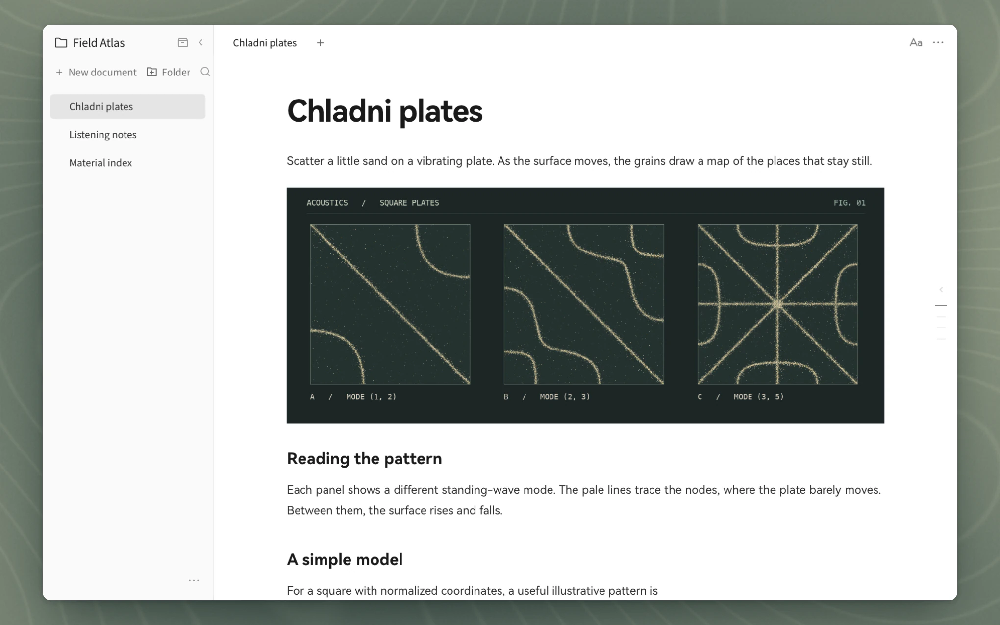
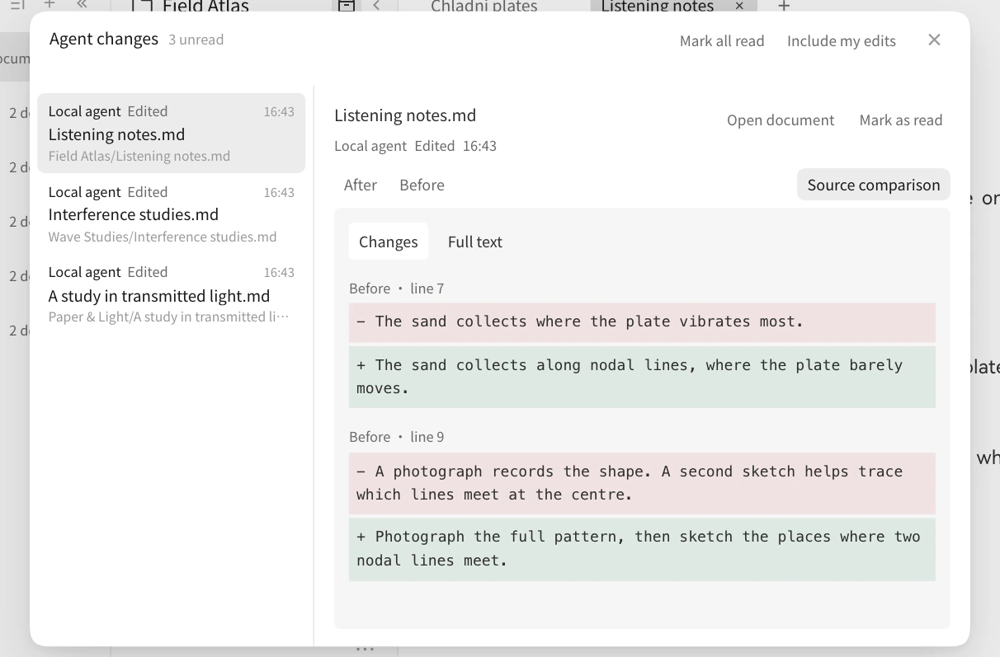
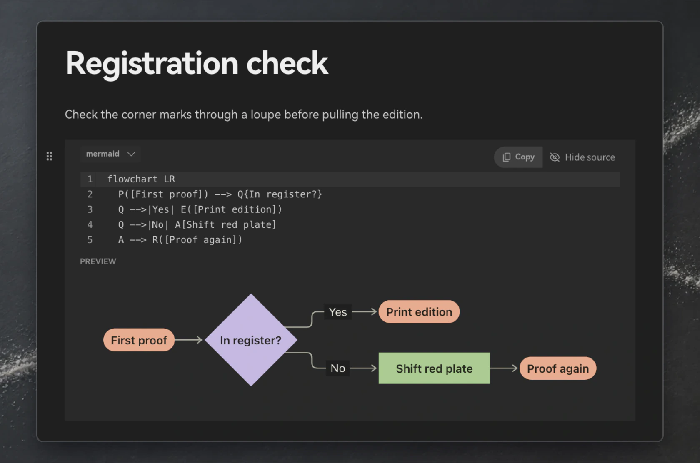
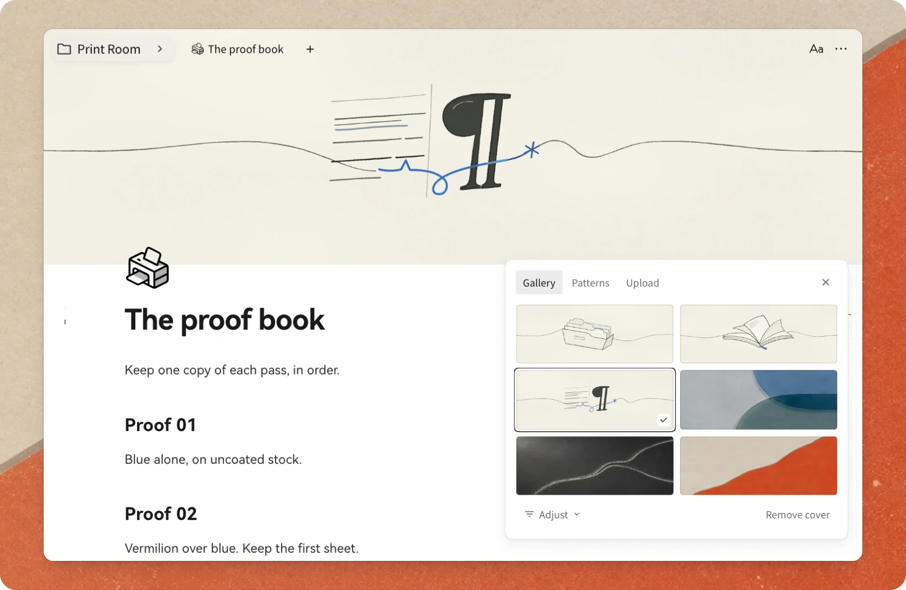

# Typocket

[简体中文](README.zh-CN.md)

Typocket is a local Markdown editor you can share with your agent. Write in the browser, hand over a passage, and review the lines your agent changed.

[Download Typocket](https://github.com/bigricedumpling/typocket/releases) · [Run it locally](#run-it-locally) · [Connect an agent](plugins/reader-workspace/README.md#connect-an-agent)



## Give your agent a passage to revise

Select a paragraph and choose **Copy for Agent**. The selection comes with the document and section it belongs to. An agent connected through Typocket can find the note, read the current version, and write the revision back.

In this print job, the blue plate was already in place. The agent corrected the instruction to move the red plate and added a proofing step before the full print run. Open **Agent changes** to compare the wording, then jump back to the note. Edits made through Typocket’s tools appear here.



## Edit a diagram on the page

A fenced Mermaid block renders where you put it in the text. Choose **View source** and edit a branch with the preview open. The file still contains ordinary Mermaid syntax. Equations work much the same way with LaTeX. Diagrams and equations are included when you export a PDF or a self-contained HTML page.



## Find the note you meant

Keep a library for each project, with folders for its notes and references. The library view gives you a glimpse of an actual page from each collection. Tabs stay open across libraries, so you can consult a reference and return to the paragraph you were editing. If you remember a phrase but forget the filename, search across the text of your notes.


## Put a familiar mark on a page

Libraries and documents can each have their own icon. A document’s icon follows it into the tab bar. The proof book below uses a little printing press and a looping ink drawing. Open the gallery to change the cover, or upload an image of your own.



## Take a document with you

Markdown files, images, PDF references, and HTML pages stay on your computer. Export **Markdown and attachments** to give someone an editable ZIP. For a read-only link, choose **Share via agent** and give the prompt to an agent that can host the selected document or library.

## Run it locally

Download the `.tgz` from [Releases](https://github.com/bigricedumpling/typocket/releases) and extract it. With Node.js 24 or newer, run this from the directory containing the extracted `package` folder, then open the local address it prints.

```sh
node package/managed-server.js
```

**Connect an agent.** In a client that supports local stdio MCP, use `node` as the command and pass the absolute path to `package/scripts/reader.mjs`, followed by `--stdio`. The setup guide includes a copyable configuration and instructions for WorkBuddy, Claude Code and Codex. [Agent setup](plugins/reader-workspace/README.md#connect-an-agent)

**Use it in DeepSeek Harness.** Install Typocket from the DSH marketplace and open it from the sidebar. The plugin starts the local service for you. Workspace Markdown opens as a preview and can be saved to your library. [DSH marketplace](https://awesome-dsh-plugin.com/?q=Typocket)

**Run from source.** With Node.js 24 or newer, run `npm ci` and `npm run dev` in the repository. [Development guide (中文)](docs/ENGINEERING.md)

*The screenshots show Preview 9 with English sample documents. Interface labels were translated for the screenshots. The current app uses Chinese.*

[Changelog (中文)](CHANGELOG.md) · [Backup and recovery (中文)](docs/DATA-AND-RECOVERY.md) · [Platform support (中文)](docs/RELEASE-READINESS.md) · [MIT license](LICENSE) · [Third-party credits](docs/THIRD-PARTY-ASSETS.md)
