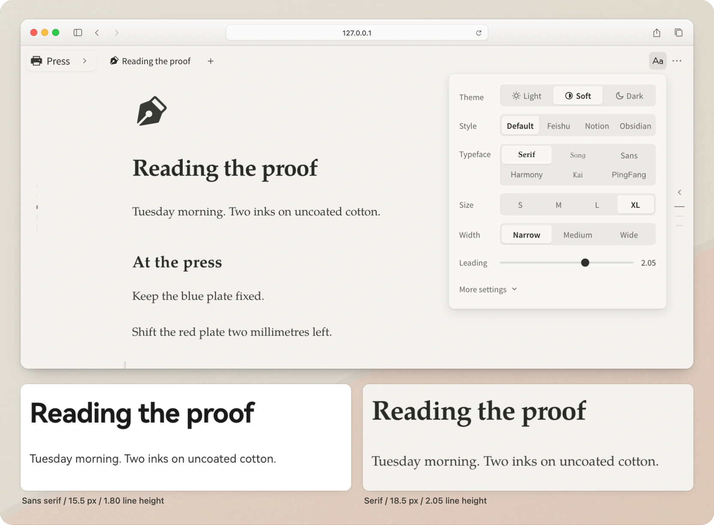
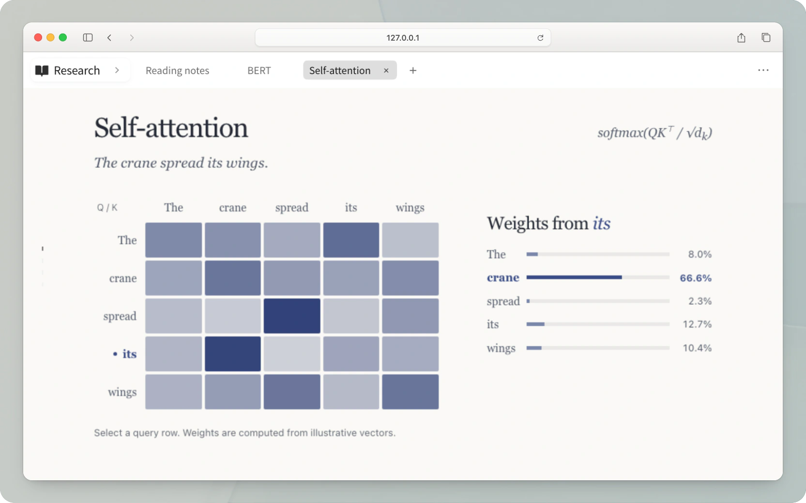
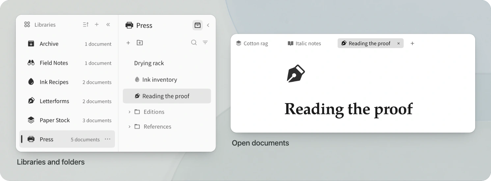
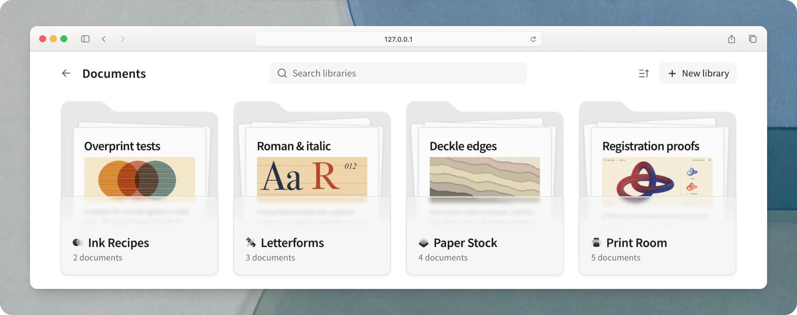

# Typocket

[简体中文](README.zh-CN.md)

Typocket is a local document reader and Markdown editor. Each library can hold Markdown notes, PDFs and HTML pages. Open the local address in a browser or in an agent’s browser sidebar that can reach localhost.

[Download](https://github.com/bigricedumpling/typocket/releases) | [Run it locally](#run-it-locally) | [Agent setup](plugins/reader-workspace/README.md#connect-an-agent) | [Bundled skill](plugins/reader-workspace/skills/reader-workspace/SKILL.md)


## Reading and editing Markdown

Edit directly on the formatted page. Selecting text opens a toolbar for emphasis, links and inline equations. The outline on the right links to each heading. Returning to a tab restores the reading position and lets you undo earlier edits to that document.


### Live typography controls

Open **Aa** to adjust the typeface, font size and text width. The current page reflows immediately, including while you drag the line-spacing slider. Additional controls cover letter spacing, paragraph indents, table width and alignment. Preferences are saved in the browser, independently of the Markdown file.

Choose a light, soft or dark appearance. The Default, Feishu, Notion and Obsidian styles also apply to the sidebar and tabs.



## Reading PDFs and HTML pages

**PDFs** support page navigation, zoom, and search. Select text in PDFs with a text layer, or follow a page reference from a note to the cited page of a paper.


*Paper excerpt from BERT by Jacob Devlin, Ming-Wei Chang, Kenton Lee and Kristina Toutanova, NAACL 2019.* [Paper](https://aclanthology.org/N19-1423/) | [CC BY 4.0](https://creativecommons.org/licenses/by/4.0/)

**HTML (H5) files** retain their layout and interactive controls. In *A Visual Explanation of Agent Harnesses*, scroll through the illustrated sequence to follow a tool request from the model to the runtime and back.



## Agent tools and revision history

The release includes the `reader-workspace` skill and local MCP tools. The skill covers document lookup, image references, revision checks and concurrent edits. A stdio MCP client receives these instructions when it connects. Agents can search and edit Markdown, or retrieve a selected PDF or HTML file for processing with their own tools. [Bundled skill](plugins/reader-workspace/skills/reader-workspace/SKILL.md) | [Agent setup](plugins/reader-workspace/README.md#connect-an-agent)

Select a passage and choose **Copy for Agent** to copy the text, document path and section heading, if present. Library excerpts include a stable document ID that survives renames. Edits saved through Typocket appear in **Agent changes**, with the old and new lines shown together. If edits to the same passage conflict, the local draft can be kept for review.


## Libraries and tabs

The sidebar organises files by library and folder. A single tab bar can hold documents from several libraries. Libraries and documents can have individual icons, and a document’s icon also appears on its tab.



The library overview shows a page from each collection. Cross-library search opens a matching passage in its Markdown file. Links between documents can point to a heading or a specific PDF page.



## Illustrations, diagrams and covers

Inline images fit the text column as it changes width. The image toolbar opens a larger view for inspecting details.


Mermaid blocks render in the document. Choose **View source** to edit a diagram with its preview visible, or type `/` to insert a mind map. LaTeX supports inline and display equations. PDF and self-contained HTML exports preserve rendered diagrams and equations.


Document covers can use an uploaded image, a still from the built-in gallery or one of the looping ink drawings.


## Files, exports and sharing

- **Export.** Save Markdown or a self-contained HTML page with images, or print to PDF. **Markdown and attachments** creates an editable ZIP containing the source and its images.
- **Share.** **Share via agent** prepares a prompt for a selected document or library. An agent with hosting access can publish a read-only snapshot and return a temporary link.
- **Back up.** Libraries are stored outside the plugin directory and survive upgrades and removal. Include the documents, attachments and metadata in a backup. [Backup and recovery (中文)](docs/DATA-AND-RECOVERY.md)

## Run it locally

Download the `.tgz` from [Releases](https://github.com/bigricedumpling/typocket/releases) and extract it. With Node.js 24 or later, run the following command from the directory containing the extracted `package` folder. The terminal prints the reader’s local address.

```sh
node package/managed-server.js
```

- **MCP setup.** Use `node` as the command. Pass the absolute path to `package/scripts/reader.mjs` as the first argument and `--stdio` as the second. See the configuration example and instructions for WorkBuddy, Claude Code and Codex. [Agent setup](plugins/reader-workspace/README.md#connect-an-agent)
- **DeepSeek Harness plugin.** Install Typocket from the community market, then choose **Start → Typocket** in the right sidebar. Workspace Markdown opens as a preview. **Save to library** creates an independent copy. [DSH community market](https://awesome-dsh-plugin.com/?q=Typocket)
- **Run from source.** Run `npm ci` followed by `npm run dev` in the repository. Set `DOCS_ROOT` to use a separate test directory. [Development guide (中文)](docs/ENGINEERING.md)

*The screenshots show Preview 9 with English sample documents. The editor currently uses Chinese. Its controls were translated for the images.*

[User guide (中文)](docs/USER-GUIDE.md) | [Changelog (中文)](CHANGELOG.md) | [Platform support (中文)](docs/RELEASE-READINESS.md) | [Report an issue](https://github.com/bigricedumpling/typocket/issues) | [MIT license](LICENSE) | [Third-party credits](docs/THIRD-PARTY-ASSETS.md)
