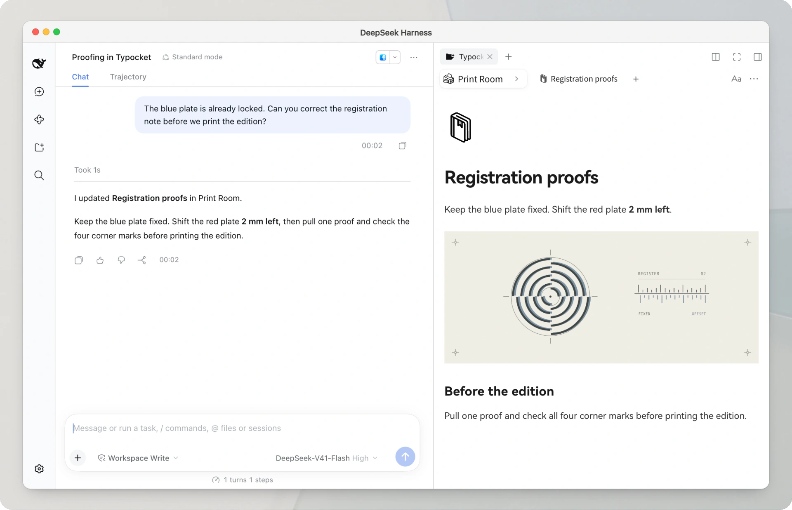
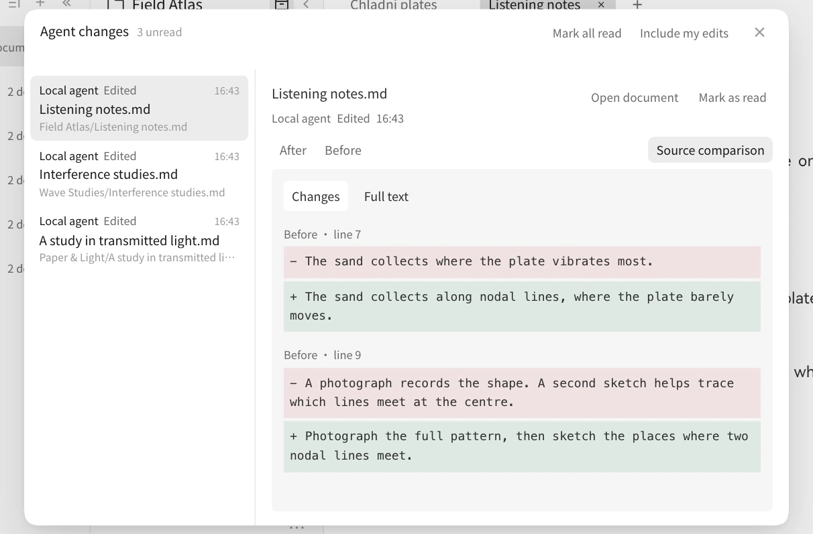
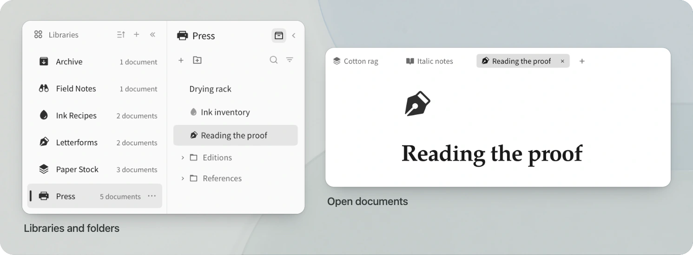
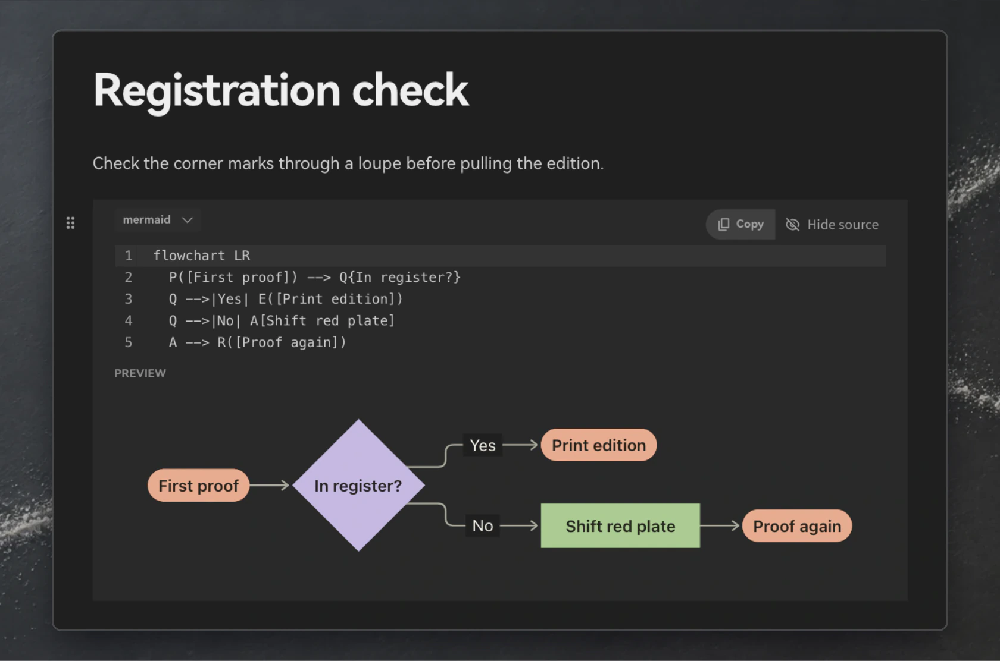
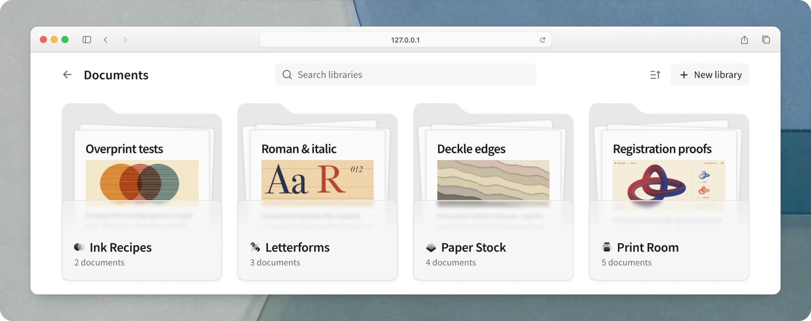
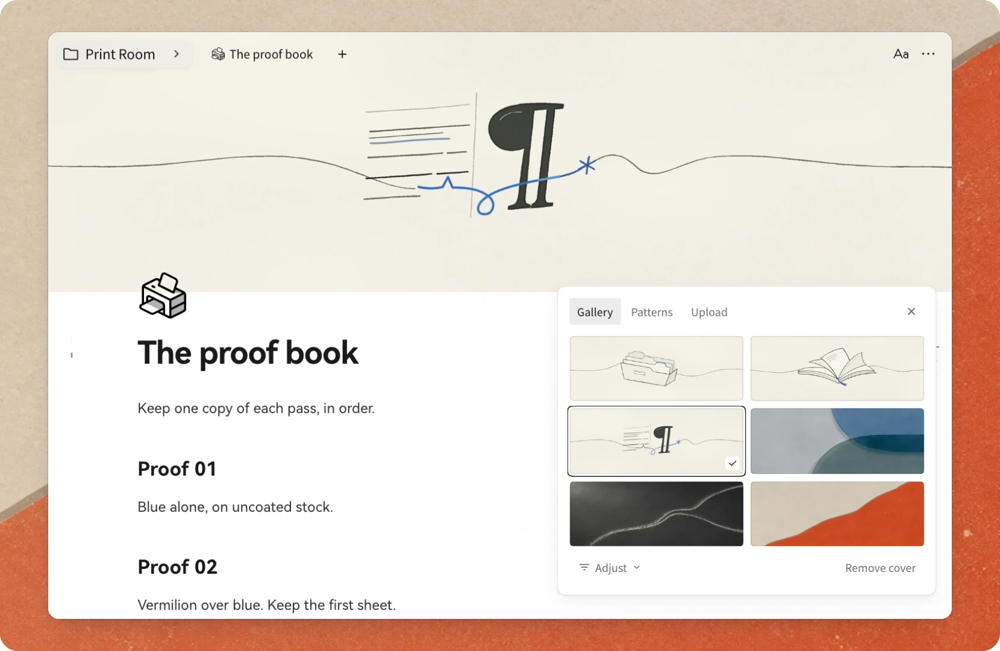

# Typocket

[English](README.md)

Typocket 是一个本地 Markdown 编辑器。你在浏览器里写，Agent 也可以改同一份文件。在 DeepSeek Harness 里，还可以把文档开在对话右边，一边讨论，一边看稿。

[下载](https://github.com/bigricedumpling/typocket/releases)　[在本机运行](#在本机运行)　[接入 Agent](plugins/reader-workspace/README.zh-CN.md)



## 正文编辑与阅读

点进正文就能写。选中一句话，旁边的小工具栏可以加粗、插链接或写行内公式。读长文时，从右侧目录跳到想看的小节，还可以在右上角的 **Aa** 里调字体、行距和正文宽度。


## 和 Agent 一起改稿

想请 Agent 改一段，选中原文，点“复制给 Agent”。复制时会带上文档路径。如果这段话在某个标题下面，小节名也会一起带上。Agent 通过 Typocket 保存后，可以在“Agent 改动”里逐行对照。图中的原稿写着“移动蓝版”，改完后，蓝版固定，红版向左移两毫米。



## 查资料时留着手头的稿子

左边选知识库，再从文件夹里找文档。不同库的文档也能并排开着。图里同时打开了纸张、字体和校样三篇笔记，查完资料，点一下顶部标签就能接着写。常看的知识库可以换个容易认的图标，文档自己的图标也会跟着出现在标签上。



<details>
<summary>展开查看文档插图、Mermaid、知识库和封面</summary>

配图可以直接放在段落之间。想看这张校样上两种油墨有没有对齐，把指针移到图上，点“查看大图”。


Mermaid 流程图和思维导图直接显示在正文里。点“查看源码”就能边改边预览。LaTeX 公式也可以随正文编辑，导出 PDF 或独立 HTML 时会保留排版。



知识库总览里能看到每个库的内页。文档可以加封面，图库里有会循环播放的纸墨线稿，也可以上传自己的图片。





</details>

## 导出与分享

想给别人一份能接着改的稿子，选“Markdown 和附件”，正文和图片会一起打包成 ZIP。只需要阅读链接时，选“通过 Agent 分享”，把提示词发给能托管网页的 Agent，由它为这篇文档或所选知识库生成临时链接。

## 在本机运行

安装 Node.js 24 或更高版本，从[发布页](https://github.com/bigricedumpling/typocket/releases)下载并解压 `.tgz`。在 `package` 文件夹的上一级目录运行以下命令，然后用浏览器打开终端显示的地址。

```sh
node package/managed-server.js
```

- **接入 Agent**　支持本机 stdio MCP 的客户端都可以连接。说明里有可复制的配置，也写了 WorkBuddy、Claude Code 和 Codex 分别怎么接。[接入说明](plugins/reader-workspace/README.zh-CN.md)
- **在 DeepSeek Harness 中安装**　在插件市场搜索 Typocket。装好后，从右侧栏的“开始”菜单打开。[DSH 社区插件市场](https://awesome-dsh-plugin.com/?q=Typocket)
- **从源码运行**　在仓库目录运行 `npm ci`，然后运行 `npm run dev`。[工程说明](docs/ENGINEERING.md)

*配图取自 Preview 9，笔记和对话均为英文示例。编辑器目前使用中文，截图里的控件名称已译成英文。*

[使用指南](docs/USER-GUIDE.md)　[更新记录](CHANGELOG.md)　[备份与恢复](docs/DATA-AND-RECOVERY.md)　[平台支持](docs/RELEASE-READINESS.md)　[MIT 许可](LICENSE)　[第三方资产](docs/THIRD-PARTY-ASSETS.md)
