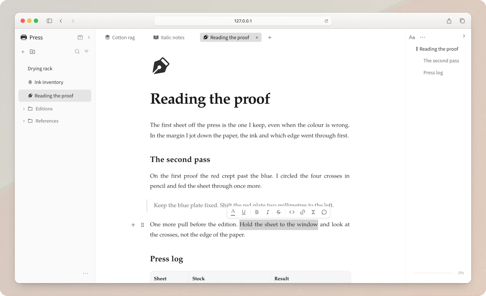
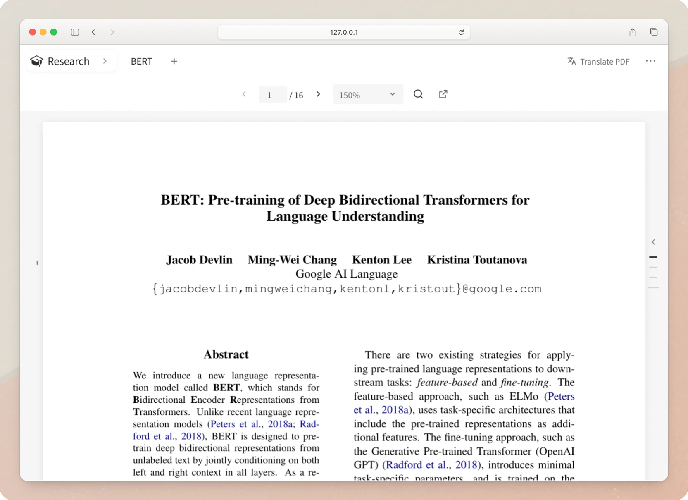
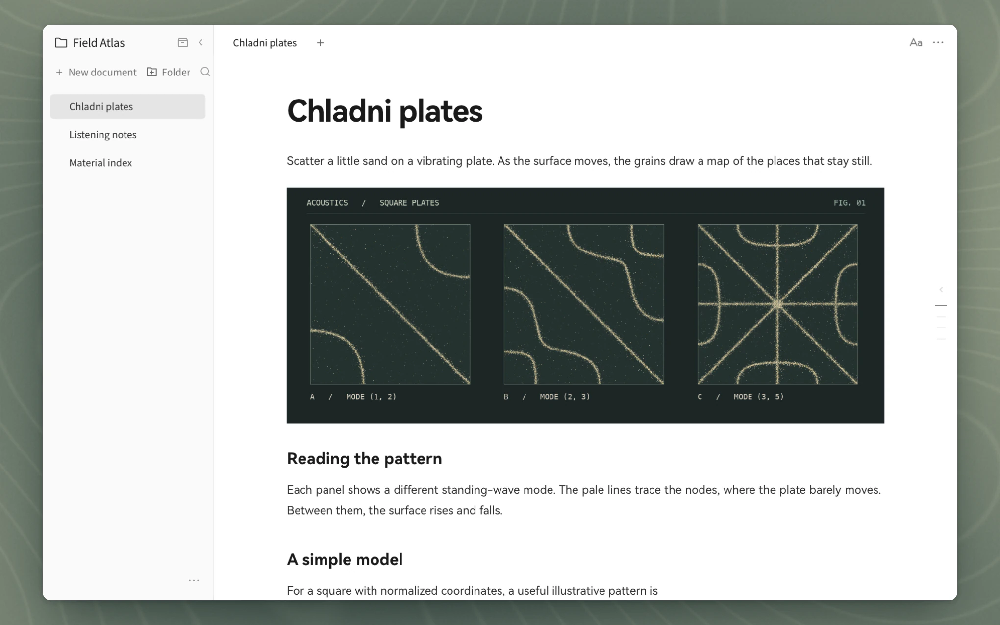

# Typocket

[English](README.md)

Typocket 是一款本地文档阅读器和 Markdown 编辑器。一个知识库可以同时收纳 Markdown 笔记、PDF 和 HTML 网页。启动后，在浏览器中打开本机地址即可使用。支持访问本机网页的 Agent 客户端也可以在浏览器侧栏中打开同一地址。

[下载](https://github.com/bigricedumpling/typocket/releases)　[在本机运行](#在本机运行)　[Agent 接入说明](plugins/reader-workspace/README.zh-CN.md)　[内置 Skill](plugins/reader-workspace/skills/reader-workspace/SKILL.md)


## Markdown 阅读与编辑

正文直接按排版效果显示。点击段落即可编辑，选中文字可加粗、插入链接或行内公式。右侧目录按标题跳转，切换文档标签后再返回，可以恢复阅读位置并继续撤销之前的编辑。



### 实时调整阅读排版

打开右上角 **Aa**，切换正文字体、字号或栏宽，当前文章会立即重新排版。拖动行距滑块时可直接观察段落的疏密。“更多排版”提供字间距、首行缩进、表格宽度与对齐等设置。阅读偏好保存在当前浏览器，Markdown 源文件保持原样。

外观有浅色、柔和、深色三种模式。主题风格另有默认、飞书、Notion 和 Obsidian，作用于正文、侧栏及标签。


## PDF 与 HTML（H5）阅读

**PDF** 支持翻页、缩放和文内查找。有文字层的 PDF 可直接选词。笔记中链接到 PDF 页码，点开即可回到引用的那一页。



*图中论文为 Jacob Devlin、Ming-Wei Chang、Kenton Lee、Kristina Toutanova 的《BERT》，NAACL 2019。* [原文](https://aclanthology.org/N19-1423/) | [CC BY 4.0](https://creativecommons.org/licenses/by/4.0/)

**HTML（H5）** 以只读方式打开，保留网页的排版和交互。图中的自注意力示例用一组演示向量计算权重。点选左侧的词，右侧图表随之更新。[HTML 示例文件](docs/examples/self-attention.html)


## Agent 工具与改稿记录

发行包内置 `reader-workspace` Skill 和本机 MCP 文档工具。Skill 说明如何定位文档、保留图片引用、按当前版本写回，以及如何处理同时编辑产生的冲突。通过 stdio MCP 连接时，客户端会收到这份说明。Agent 可以检索和修改 Markdown，也能读取选定 PDF、HTML 的原文件交给自己的工具处理。[内置 Skill](plugins/reader-workspace/skills/reader-workspace/SKILL.md)　[接入配置](plugins/reader-workspace/README.zh-CN.md)

选中正文后点“复制给 Agent”，即可复制原文、文档路径和所在小节（如有）。知识库文档的选段还带有固定 ID，改名后仍可定位。通过 Typocket 工具保存的修改会出现在“Agent 改动”中，可以逐行对照前后两个版本。如果同一段落出现冲突，可保留本地草稿再处理。


## 知识库与跨库导航

左侧栏按知识库和文件夹组织文档。顶部标签可以同时打开不同库的资料。知识库和文档可分别设置图标，文档图标也会显示在对应标签上。


知识库总览会显示各库的内页预览。使用侧栏搜索中的“跨库正文”可从一句原文找到对应的 Markdown 段落。文档间的链接支持跳到指定标题或 PDF 页码。


## 插图、图表与封面

图片可以嵌在段落之间，随正文栏宽缩放。将指针移到图片上，选择“查看大图”可放大检查细节。



Mermaid 代码块在正文中显示为图表，点“查看源码”可同时编辑和预览。输入 `/` 可以插入思维导图。LaTeX 支持行内公式和独立公式，导出 PDF 或独立 HTML 时会保留图表和公式的排版。


文档封面支持上传图片，也可以从内置图库中选择静态图片或循环播放的纸墨线稿。


## 文件、导出与分享

- **导出**　支持 Markdown、含图片的独立 HTML、打印或保存为 PDF。选择“Markdown 和附件”可将可编辑的正文和配图一起打包为 ZIP。
- **分享**　“通过 Agent 分享”会为选中的文档或知识库生成提示词。具备网页托管能力的 Agent 可据此生成只读快照，并返回临时链接。
- **备份**　知识库保存在插件目录之外，升级或卸载插件后仍保留在本机。备份时请同时保留正文、附件和元数据。[备份与恢复](docs/DATA-AND-RECOVERY.md)

## 在本机运行

安装 Node.js 24 或更高版本，从[发布页](https://github.com/bigricedumpling/typocket/releases)下载并解压 `.tgz`。在解压所得的 `package` 文件夹的上一级目录运行以下命令。终端会显示阅读器的本机地址。

```sh
node package/managed-server.js
```

- **MCP 接入**　命令为 `node`，两个参数依次为 `package/scripts/reader.mjs` 的绝对路径和 `--stdio`。接入说明包含配置示例和 WorkBuddy、Claude Code、Codex 的安装方式。[Agent 接入说明](plugins/reader-workspace/README.zh-CN.md)
- **DeepSeek Harness 插件**　在社区市场安装后，从右侧栏的“开始”菜单打开 Typocket。工作区 Markdown 可直接预览，点击“保存到知识库”会创建独立副本。[DSH 社区插件市场](https://awesome-dsh-plugin.com/?q=Typocket)
- **从源码运行**　在仓库目录执行 `npm ci` 和 `npm run dev`。可通过 `DOCS_ROOT` 指定测试目录。[工程说明](docs/ENGINEERING.md)

*配图取自 Preview 9，使用英文示例资料。编辑器目前使用中文，截图中的控件名称已译为英文。*

[使用指南](docs/USER-GUIDE.md)　[更新记录](CHANGELOG.md)　[平台支持](docs/RELEASE-READINESS.md)　[报告问题](https://github.com/bigricedumpling/typocket/issues)　[MIT 许可](LICENSE)　[第三方资产](docs/THIRD-PARTY-ASSETS.md)
