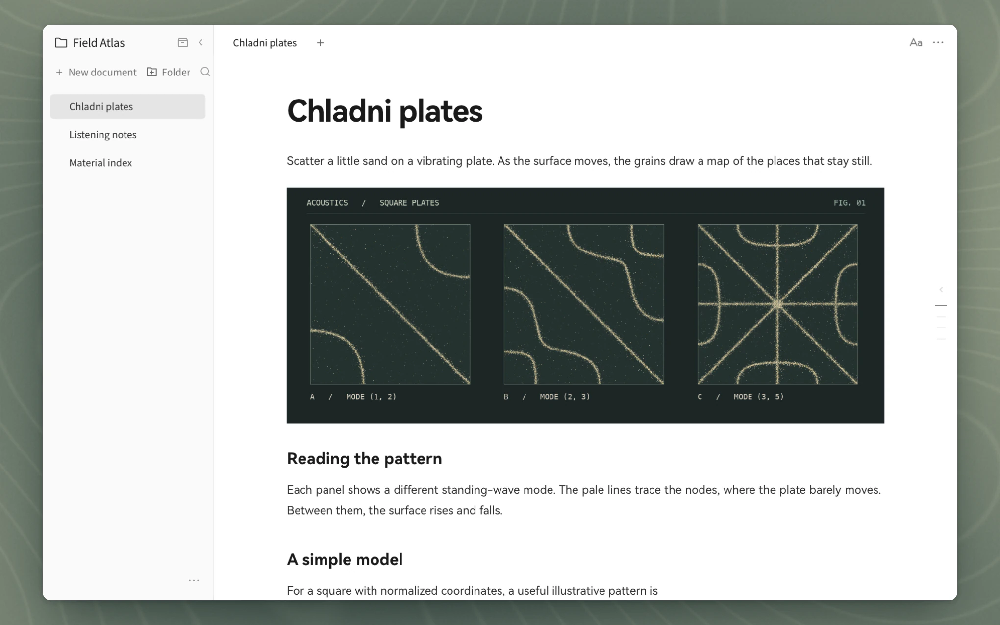

# Typocket

Typocket 是 DSH 中的个人文档工具，方便你阅读 Agent 的工作成果，继续编辑 Markdown，并将有用的资料保存到本机知识库。PDF 和 HTML 页面也可一起预览。插件安装包包含完整网页和本机服务。启用插件后自动启动，无需另装 Typocket、Node.js 或运行终端命令。



## 安装

1. 在 [DSH 社区插件市场](https://awesome-dsh-plugin.com/?q=Typocket)搜索 Typocket 并安装。手动安装时，从 [GitHub 发布页](https://github.com/bigricedumpling/deepseek-reader/releases)下载所需版本的 `.tgz`，在 DSH NEXT 的「插件 → 添加插件」中选择该文件。
2. 在右侧栏「开始」页点击「Typocket」。首次使用会自动创建本机数据目录。
3. 在 DSH 文件区打开 Markdown，可用 Typocket 预览；在 Typocket 顶栏点外部打开图标，可在浏览器打开当前页面。

## 本机数据

macOS 默认知识库目录是 `~/Library/Application Support/Reader/知识库`。它不在插件安装目录中，更新或卸载插件不会删除文档。本机服务只监听回环地址，并会保存首次分配的端口供重启复用。

如果本机 `127.0.0.1:8090` 已有旧 Typocket，插件会先接入它，继续使用原来的资料；旧服务离线时会提示离线，避免切换到另一份空库。迁移旧目录前请先备份。需要沿用原目录的高级用户可在启动 DSH 前设置 `DSH_READER_DATA_DIR`，插件不会自行移动旧数据。在插件详情中可手动连接另一台 Typocket；远程地址需使用 HTTPS。

## 工作区 Markdown 与 Agent

工作区 Markdown 预览只读。相对链接继续打开工作区文件，相对图片从当前工作区读取；预览不会移动原文件。想保留时在预览页直接「保存到知识库」，生成知识库中的独立副本；不收录就不保留浏览记录。收进知识库后，点 Mermaid 图表上的「查看源码」即可修改图表，导出网页或打印时也会带上图表。

文档「更多」菜单中的「通过 Agent 分享」可为一篇文档或整个知识库复制分享提示词。将它交给有临时托管能力的 Agent，即可让它制作只读快照并返回网址。

在支持技能的 DSH NEXT 中，启用插件后即可让 Agent 使用 `reader-workspace`。例如，告诉它「在项目资料里找到会议纪要，帮我把最后一段改短，保留原图」。插件向 DSH 注册文档工具，遵循会话的只读和工作区权限。本机连接无需配置 Typocket 令牌。在默认的工作区写入模式下，如果知识库位于工作区之外，DSH 会询问是否允许本次写入。

## 在其他 Agent 中使用

1. 准备完整插件目录。可以解压 DSH 安装包，解压后的 `package` 目录内应当有 `managed-server.js`、`scripts` 和 `runtime`。
2. 如果本机已有 Typocket 在运行，可以直接连接。单独使用时，用 Node.js 24 或更新版本执行 `node "/插件绝对路径/managed-server.js"`，保持这个进程运行。它会显示可在浏览器打开的地址。
3. 在 Agent 的 MCP 设置中添加一个 **stdio** 服务器，命令填 `node`，参数依次填桥接脚本的绝对路径和 `--stdio`。支持 JSON 配置的宿主可使用以下内容，替换为本机路径。

```json
{
  "mcpServers": {
    "typocket": {
      "command": "node",
      "args": ["/插件绝对路径/scripts/reader.mjs", "--stdio"]
    }
  }
}
```

不同宿主的入口如下。

- **WorkBuddy**　在「连接器 → 自定义连接器」中添加上面的 MCP 服务。[WorkBuddy 连接器说明](https://www.codebuddy.cn/docs/workbuddy/From-Beginner-to-Expert-Guide/Function-Description/Connector)
- **Claude Code**　启动本地会话时使用 `claude --plugin-dir "/插件绝对路径"`，从同一目录加载技能和 MCP 工具。
- **Codex CLI**　使用源码仓库时，运行 `codex plugin marketplace add "/Typocket仓库绝对路径"`，再运行 `codex plugin add reader-workspace@typocket`。打开新的会话后可用。仅持有解压包时也可按上面的通用方式添加 MCP。

连接后可以让 Agent「列出我在 Typocket 中的知识库」。桥接脚本会查找本机服务。如果你已启动另一个实例，可在该 MCP 服务器的环境变量中设置 `READER_URL` 为它的本机地址，并用 `DOCS_ROOT` 指定预期的知识库根目录。旧服务若提示需要更新，请先更新并重启对应实例。

随包的[使用技能](skills/reader-workspace/SKILL.md)也会在 MCP 握手时交给客户端。仅导入技能的宿主，还需要可用的本机服务和工具、命令行或 HTTP 访问能力。浏览器中的云端 Agent 需要宿主提供本机连接。

## 支持范围与已知问题

- 插件面向 macOS、Windows 和 Linux。macOS 已验证 DSH NEXT 的安装链。Windows 和 Linux 的原生 DSH 安装与桌面交互仍待验收。
- 单篇内容交付使用导出；导出不会随后续编辑自动更新。
- 工作区文件与知识库副本独立，不提供双向同步或多人协作。
- 在 macOS DSH NEXT 的两个原生窗口中可以同时打开同一个知识库。两处写入冲突时可另存副本；卸载插件后原文和副本继续留在本机。

源代码采用 [MIT License](LICENSE)。字体、PDF 阅读组件和图标的来源与许可见[第三方资产](https://github.com/bigricedumpling/deepseek-reader/blob/main/docs/THIRD-PARTY-ASSETS.md)。
